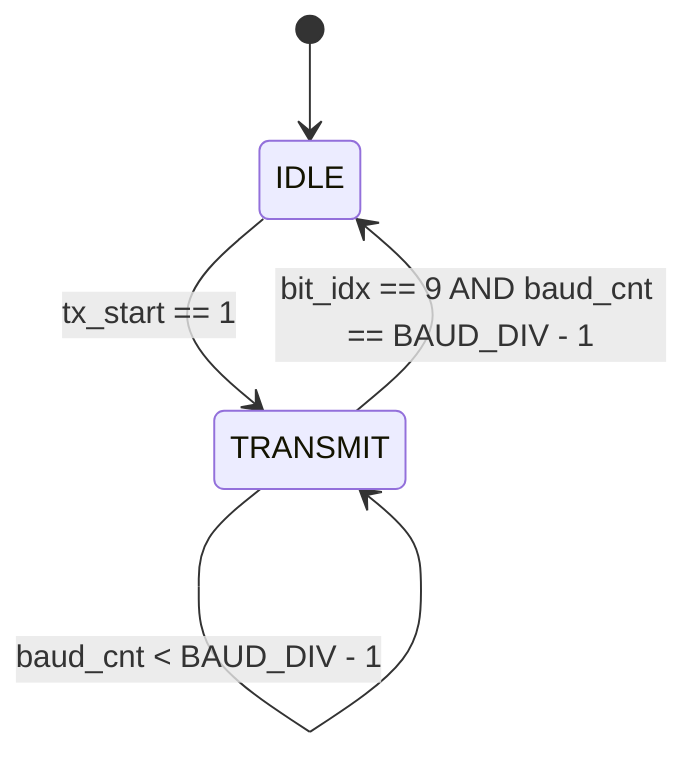
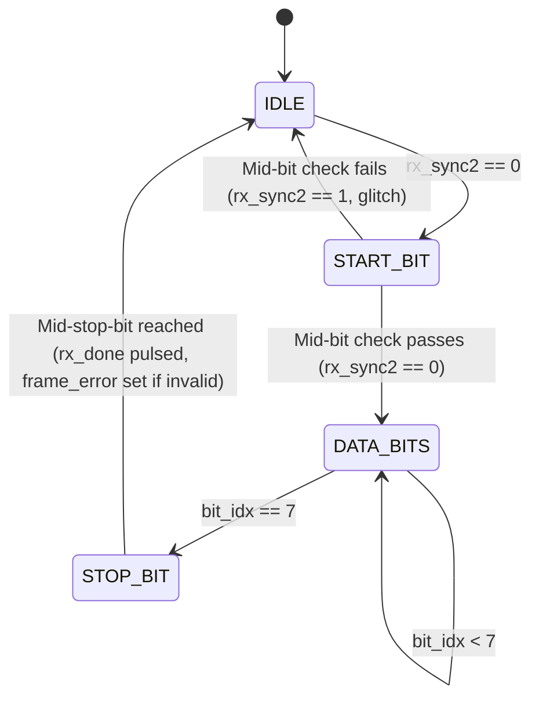

# UART Architecture & Implementation Specification

## 1. Overview of UART Protocol (8N1 Standard)

**UART** (Universal Asynchronous Receiver-Transmitter) is a hardware communication protocol that transmits serial data asynchronously without a shared clock signal.

### Frame Format (8N1)
Each frame consists of **10 bits**:
1. **Start Bit (`0`)**: 1 bit period low signal indicating the start of transmission.
2. **Data Bits (`D0` to `D7`)**: 8 bits of payload data, sent **LSB (Least Significant Bit) first**.
3. **Stop Bit (`1`)**: 1 bit period high signal indicating frame completion and returning the line to idle.

```
       +-------+     +----+----+----+----+----+----+----+----+     +-------+
Idle   | Start |     | D0 | D1 | D2 | D3 | D4 | D5 | D6 | D7 |     | Stop  |  Idle
(HIGH) | (LOW) |     |LSB |    |    |    |    |    |    |MSB |     |(HIGH) | (HIGH)
-------+       +-----+----+----+----+----+----+----+----+----+-----+       +-------
       <--1bit->     <----------------- 8 bits ------------->     <--1bit->
```

---

## 2. Baud Rate Generation

Because there is no shared clock wire between TX and RX, both sides must agree on a predefined **Baud Rate** (bits per second, e.g., 115,200 bps or 9,600 bps).

The clock divider ratio is computed as:
$$\text{BAUD\_DIV} = \frac{f_{\text{clk}}}{\text{BAUD\_RATE}}$$

### Example Calculation
For a system clock $f_{\text{clk}} = 50\text{ MHz}$ and Baud Rate $= 115,200\text{ bps}$:
$$\text{BAUD\_DIV} = \frac{50,000,000}{115,200} \approx 434\text{ clock cycles per bit}$$

---

## 3. Transmitter Architecture (`rtl/uart_tx.v`)

The UART Transmitter accepts an 8-bit parallel byte (`tx_data`) when `tx_start` is pulsed high, constructs the 10-bit frame, and serializes it bit-by-bit onto `tx_out`.

### Transmitter Finite State Machine (FSM)



- **IDLE**: Output line `tx_out = 1`. `tx_busy = 0`. When `tx_start` is asserted:
  - Form 10-bit vector `tx_frame = {1'b1, tx_data[7:0], 1'b0}`.
  - Set `tx_out = 1'b0` (Start Bit).
  - Set `tx_busy = 1'b1`.
  - Transition to `TRANSMIT`.
- **TRANSMIT**: Hold bit output for `BAUD_DIV` clock cycles. Increment `bit_idx` every `BAUD_DIV` cycles. When `bit_idx == 9` and `baud_cnt == BAUD_DIV - 1`, set `tx_busy = 0` and return to `IDLE`.

---

## 4. Receiver Architecture (`rtl/uart_rx.v`)

The UART Receiver deserializes incoming bits on `rx_in` into an 8-bit parallel register `rx_data`.

### Key Receiver Features
1. **Metastability Protection (2-Stage Synchronizer)**:
   The external serial line `rx_in` is asynchronous to `clk`. It passes through two cascaded flip-flops (`rx_sync1`, `rx_sync2`) before entering the FSM.
2. **Mid-Bit Sampling**:
   Sampling in the exact center of each bit period yields maximum noise margin. The start bit center is reached at:
   $$\text{HALF\_BAUD\_DIV} = \frac{\text{BAUD\_DIV}}{2}$$
   Subsequent data bits are sampled every `BAUD_DIV` cycles.
3. **False Start Bit Filtering**:
   At `HALF_BAUD_DIV` cycles into the start bit, `rx_sync2` is verified. If `rx_sync2 == 1` (a short noise spike/glitch), the FSM aborts reception and returns immediately to `IDLE`.
4. **Frame Error Detection**:
   When sampling the stop bit position, if `rx_sync2 == 0` (instead of `1`), `frame_error` is asserted high.

### Receiver State Machine (FSM)



---

## 5. Top-Level Module (`rtl/uart_top.v`)

Integrates `uart_tx` and `uart_rx` with a configurable internal loopback multiplexer.
- When `loopback_en = 1`: Internal loopback (`tx_out` connected directly to `rx_in`).
- When `loopback_en = 0`: Physical external serial interface via `tx_pin` and `rx_pin`.
